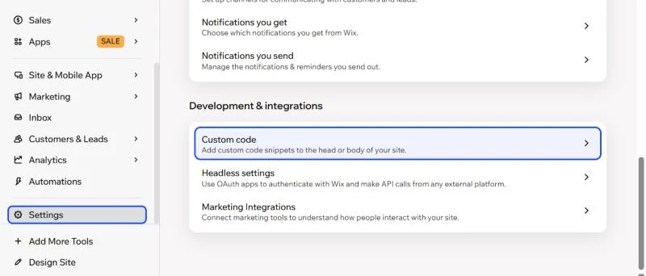
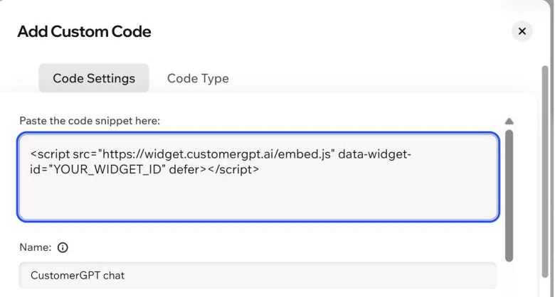
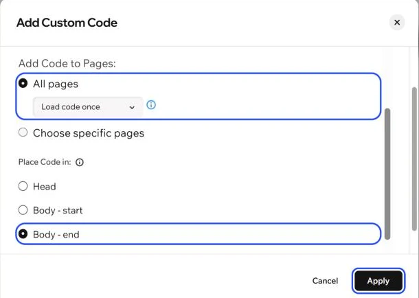

Before you start, copy the **HTML Script** code from **Customizer → Get Embed Code**. See [Add the chatbot to your website](/install/add-to-your-website).

<Note>
  Wix runs custom code only on a published site with a connected domain, and connecting a domain needs a Wix Premium plan.
</Note>

## Add it to every page

1. In your Wix dashboard, click **Settings** in the sidebar.
2. Scroll to **Development & integrations** and click **Custom code**.

   <Frame>
     
   </Frame>

3. Click **+ Add Custom Code**.
4. Paste the embed code into **Paste the code snippet here**, and enter a **Name**, for example `CustomerGPT chat`.

   <Frame>
     
   </Frame>

5. Under **Add Code to Pages**, keep **All pages** and **Load code once**.
6. Under **Place Code in**, select **Body - end**.
7. Click **Apply**.

   <Frame>
     
   </Frame>

The widget loads only on your chatbot's domain, so check the published site on your connected domain, not the Wix Editor or its preview. The bubble appears in the bottom-right corner.

## Add it to one page only

In step 5, choose **Choose specific pages** instead of **All pages**, and pick the page.

## Your connected domain

The widget loads only on the domain you entered as **Website Domain Link**. Enter your Wix site's connected domain there, the address your visitors see. See [Where the widget is allowed to load](/install/add-to-your-website#where-the-widget-is-allowed-to-load).

Wix keeps custom code per domain. If you connect a different domain to your site, Wix deletes your code snippets: add the embed code again, and change the chatbot's domain to the new one.

## Train the chatbot on your Wix content

Crawl your site from **Knowledge Base**, as described in [Add your website](/knowledge/add-your-website). Wix publishes a sitemap index at `/sitemap.xml`, and with the CLI you can train on the pages it lists, including those in the sitemaps it points to:

```bash
customergpt knowledge sitemap add https://acme.com/sitemap.xml --chatbot BOT_ID --max-pages 20 --yes --wait
```
